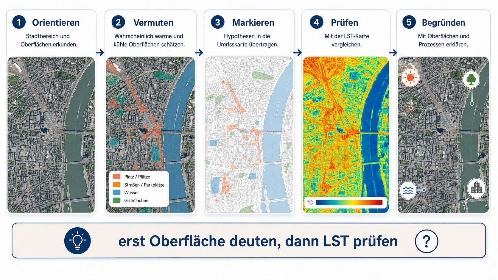
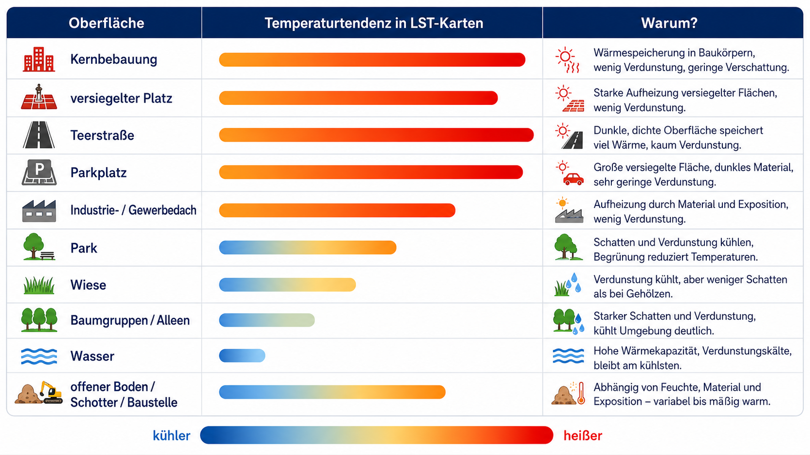

# Ziel: Hitzeinseln aus Satelittendaten und Luftbildern in QGIS analysieren

In QGIS werden zwei Rasterdaten geladen:

1. ein aktuelles Luftbild für die sichtbare Stadtstruktur;
2. ein thermisches Landsat-Band, aus dem eine Karte der Oberflächentemperatur in °C entsteht.

Die erwarteten warmen und kühlen Bereiche werden zuerst aus dem Luftbild hergeleitet. Danach werden sie mit der Landsat-Karte verglichen. QGIS automatisiert diesen Lernschritt nicht: Flächen werden von Hand markiert, beschrieben und geprüft.

::: {.callout-important}
**Wärmebild heißt hier Oberflächentemperatur.** Die Karte misst nicht die Lufttemperatur in 2 m Höhe und auch nicht direkt die menschliche Wärmebelastung.
:::

{fig-align="center" width="90%"}

# Das Modell in drei Schritten

| Schritt | Leitfrage | Ergebnis in QGIS |
|---|---|---|
| **Erwartung** | Welche Flächen müssten sich bei Sonne eher stark oder eher wenig erwärmen? | Manuell gezeichnete Erwartungsflächen auf dem Luftbild |
| **Struktur** | Wie sind die erwarteten warmen Flächen im Stadtraum angeordnet? | Zusammenhängende Blöcke, große Dächer, Straßenräume und Kontraste zu Grün und Wasser |
| **Abgleich** | Wo liegen im Landsat-Bild tatsächlich hohe Oberflächentemperaturen? | Sichtbarer Vergleich, dokumentierte Übereinstimmungen und Abweichungen |

Das Modell fasst reale Oberflächen zu drei Arbeitsklassen zusammen. Es liefert eine begründete Erwartung, keine vollständige Stadtklimaanalyse.

| Arbeitsklasse | Beispiele im Marburger Stadtraum | Erwartete Tendenz |
|---|---|---|
| **Versiegelt / bebaut** | Dächer, Straßen, Parkplätze, Plätze, Bahn- und Gewerbeflächen | häufig wärmer, besonders bei wenig Schatten und geringer Verdunstung |
| **Vegetation** | Stadtwald, Parks, Baumgruppen, Grünzüge, Gärten | häufig kühler durch Schatten und Verdunstung; trockene Wiesen sind ein Grenzfall |
| **Wasser** | Lahn, Teiche und Becken | oft andere, tagsüber häufig kühlere Temperaturantwort als befestigte Flächen |

{fig-align="center" width="88%"}

# 1. Luftbild für Marburg laden

## Quelle und Zugang

Das Land Hessen stellt digitale Orthophotos als WMS bereit. Der Dienst enthält RGB-Luftbilder; im Geoportal Hessen wird die DOP-Produktion mit 20 cm Bodenauflösung beschrieben. Ein WMS ist ein Kartendienst. In QGIS kann der sichtbare Ausschnitt als georeferenziertes Raster exportiert werden.

- [Hessen Geodatenmanagement: Orthophotos und TrueDOP](https://hvbg.hessen.de/landesvermessung/geotopographie/luftbilder/digitale-orthophotos-true-orthophoto)
- [Offizieller WMS- und Diensthinweis](https://hvbg.hessen.de/geoinformation/geodateninfrastruktur/geoportal-hessen/geodatendienste-im-originaeren-format)
- [Universitätsstadt Marburg: Luftbilder](https://www.marburg.de/buergerservice/dienstleistungen/luftbilder-900000471-0.html?myMedium=1) – lokale Befliegungsjahrgänge und Kontakt für weitere Daten.
- [QGIS herunterladen](https://qgis.org/download/)
- WMS-Adresse zum Einfügen in QGIS: `https://www.gds-srv.hessen.de/cgi-bin/lika-services/ogc-free-images.ows`
- RGB-Layer: `he_dop20_rgb`

## In QGIS einbinden und speichern

1. QGIS öffnen und das Projekt-KBS auf **EPSG:25832 – ETRS89 / UTM Zone 32N** setzen.
2. **Layer → Layer hinzufügen → WMS/WMTS-Layer hinzufügen** öffnen und eine neue Verbindung anlegen.
3. Name: `Hessen DOP RGB`; URL: die oben genannte WMS-Adresse. Verbindung herstellen.
4. Den Layer `he_dop20_rgb` auswählen und hinzufügen.
5. Zur Stadt Marburg zoomen. Wähle einen gut erkennbaren Ausschnitt, zum Beispiel Innenstadt und Lahn oder einen konkreten Schul- bzw. Untersuchungsraum.
6. Im Layer-Kontextmenü **Exportieren → Speichern als…** wählen. Als Format GeoTIFF, als KBS EPSG:25832 und als Dateiname `marburg_luftbild.tif` setzen. Den aktuellen Kartenausschnitt exportieren.

Das exportierte Bild ist ein gerendertes RGB-Luftbild. Es enthält keine NIR-Messwerte und ist nicht die Grundlage einer automatischen Vegetationsklassifikation. Prüfe im Quellenhinweis des Kartenlayouts die aktuellen Angaben zur Hessischen Verwaltung für Bodenmanagement und Geoinformation (HVBG). Die amtliche Produktseite nennt für Hessen einen zweijährlichen Aktualisierungsturnus; das Bildflugjahr kann je Ausschnitt variieren.

# 2. Landsat-Wärmebild für Marburg laden

## Quelle und Produktauswahl

Landsat Collection 2 Level-2 enthält ein fertiges Surface-Temperature-Band (`ST_B10`) als GeoTIFF. Für eine möglichst einfache erste Übung wird eine einzelne, möglichst wolkenarme Landsat-8- oder Landsat-9-Aufnahme aus Juni bis August gewählt.

- [USGS EarthExplorer](https://earthexplorer.usgs.gov/) – Suche und kostenloser Download; Anmeldung erforderlich.
- [USGS: Landsat Collection 2 Level-2](https://www.usgs.gov/landsat-missions/landsat-collection-2-level-2-science-products) – Produkterklärung und Zugang.
- [USGS: Surface Temperature und Skalierungsfaktor](https://www.usgs.gov/landsat-missions/landsat-collection-2-surface-temperature) – Umrechnung der gespeicherten Werte.
- [USGS: QA_PIXEL Qualitätsband](https://www.usgs.gov/landsat-missions/landsat-collection-2-quality-assessment-bands) – Wolken- und Schatteninformationen.
- [QGIS-Handbuch: Rasterrechner](https://docs.qgis.org/3.44/de/docs/user_manual/working_with_raster/raster_analysis.html)

Im EarthExplorer:

1. Suchgebiet über die Koordinaten von Marburg oder durch Aufziehen eines Rechtecks setzen (Stadtzentrum ungefähr **50.81° N, 8.77° E**).
2. Zeitraum auf Sommermonate setzen und Ergebnisse mit möglichst geringem Wolkenanteil ansehen.
3. Unter **Data Sets → Landsat → Landsat Collection 2 Level-2** den Datensatz **Landsat 8-9 OLI/TIRS C2 L2** auswählen.
4. Eine Szene mit klarer Abdeckung des Untersuchungsraums und niedrigem Wolkenanteil wählen. Datum und Szenen-ID notieren.
5. Im Download-Angebot nur das Band **Surface Temperature (ST_B10)** herunterladen. Für die Minimalübung wird kein zusätzliches Raster benötigt.

Das ST-Band wird als skalierter Integer geliefert. Der USGS gibt für Collection 2 an:

$$
T_{K} = DN \times 0{,}00341802 + 149{,}0
$$

$$
T_{°C} = T_{K} - 273{,}15
$$

Landsat 8/9 Thermal Infrared wird mit 100 m erfasst und auf ein 30-m-Raster gebracht. Das Raster sieht daher feiner aus, als die tatsächliche thermische Detailauflösung ist. Kleine Straßen, Einzelbäume oder einzelne Gebäude lassen sich damit nicht zuverlässig voneinander trennen.

# 3. Temperaturkarte in QGIS berechnen

1. Das GeoTIFF `ST_B10` per Drag-and-drop oder **Layer → Layer hinzufügen → Rasterlayer hinzufügen** in QGIS laden.
2. In der Verarbeitungstoolbox **Rasteranalyse → Rasterrechner** öffnen.
3. Im Ausdruck den Bandnamen aus der Liste einfügen. Er sieht ungefähr so aus:

```text
"LC08_..._ST_B10@1" * 0.00341802 + 149.0 - 273.15
```

4. Ausgabe als Float-Raster in Grad Celsius speichern, z. B. `marburg_lst_[Aufnahmedatum]_celsius.tif`. Falls der Bandname länger ist, ihn in der Layerliste des Rasterrechners doppelt anklicken.
5. Der Fill-Wert `0` ist kein Temperaturmesswert. Schließe ihn im Rasterrechner aus:

```text
if("LC08_..._ST_B10@1" = 0, 0 / 0,
   "LC08_..._ST_B10@1" * 0.00341802 + 149.0 - 273.15)
```

`0 / 0` erzeugt im Rasterrechner einen NoData-Pixel. Passe den Bandnamen an deine Datei an. Prüfe anschließend die Statistik: plausible sommerliche Oberflächentemperaturen sollen keine großen Flächen mit etwa −124 °C enthalten.
6. Für die Darstellung **Eigenschaften → Symbolisierung → Einkanal-Pseudofarbe** wählen. Einen Farbverlauf von kühlen zu warmen Farben setzen und Klassen aus den tatsächlichen Min-/Max-Werten des Ausschnitts bilden. Die Skala beschriften, zum Beispiel `Oberflächentemperatur (°C)`.

::: {.callout-warning}
Wolken oder Wolkenschatten können einzelne Temperaturbereiche verfälschen. Diese Minimalübung verwendet kein separates QA-Raster; deshalb eine wolkenarme Szene auswählen und die Karte visuell auf Wolkenreste prüfen. Für belastbare Analysen muss QA_PIXEL zur Maskierung genutzt werden.
:::

# 4. Erwartung und tatsächliche Hotspots vergleichen

1. `marburg_luftbild.tif` und `marburg_lst_celsius.tif` in dasselbe QGIS-Projekt laden. QGIS zeigt unterschiedliche KBS bei Bedarf durch Bildschirmtransformation gemeinsam an.
2. Das Luftbild zuerst allein ansehen. Temperatur-Layer ausblenden.
3. In **Layer → Neuer temporärer GeoPackage-Layer…** einen Polygonlayer für die Erwartungsflächen erzeugen. Ein Feld `erwartung` (Text) genügt. Alternativ einen GeoPackage-Layer über **Layer → Layer erstellen → Neuer GeoPackage-Layer…** dauerhaft speichern.
4. Einige größere Flächen von Hand digitalisieren und mit `warm`, `mittel` oder `kuehl` beschreiben. Die Flächen sollen auf dem Luftbild erkennbaren Oberflächen folgen, nicht einzelne 30-m-Rasterpixel.
5. Eine zweite Attributspalte `begruendung` nutzen: etwa `versiegelt`, `Schatten`, `Vegetation`, `Wasser` oder `Mischfläche`.
6. Die Erwartungsflächen transparent mit Umriss darstellen. Jetzt den Wärme-Layer einschalten und prüfen, ob erwartete Hotspots tatsächlich mit hohen Oberflächentemperaturen zusammenfallen.
7. Übereinstimmungen und Abweichungen notieren. Mögliche Gründe sind Schatten, Feuchte, Material, Aufnahmezeit, Mischpixel oder Wolkenreste.

Es entstehen nur zwei heruntergeladene Rasterbilder. Die Erwartungsflächen sind eine eigene, von Hand erstellte Interpretation im Projekt. Sie sind kein drittes Ausgangsbild.

# Bezug zum automatisierten Lehrkräfte-Workflow

Der bisherige R-Workflow ist auf die vorhandene Köln-Demo ausgerichtet. Er sucht Landsat-8/9-L2-Szenen, berechnet daraus einzelne LST-Raster, wählt für den Hot-Modus die zehn Szenen mit dem höchsten gebietsweiten q90-Wert und erstellt daraus ein pixelweises q90-Komposit. Zusätzlich erzeugt er eine vereinfachte Oberflächenmaske aus einem CIR-Bild und richtet ein QGIS-Projekt mit Layouts ein. Für Marburg ist der Workflow nicht einfach durch Umbenennen des Ausgabeordners umgestellt; AOI und Verarbeitung müssten angepasst werden.

Dieser manuelle Einstieg übernimmt die zentrale Modellidee und die QGIS-Deutung, lässt aber die automatischen Schleifen und Zusatzprodukte weg: eine Landsat-Szene, eine Wärme-Rasterdatei, ein Luftbild und händisch eingezeichnete Erwartungsflächen. **Eine einzelne Szene ist kein Hot-q90-Komposit.** Das Ergebnis ist ein leicht nachvollziehbarer Temperatur-Schnappschuss; für den exakten Vergleich mit dem automatisierten Lehrkräfteprodukt müssten dieselben zehn Szenen und dieselbe q90-Berechnung verwendet werden.

Die Skripte bleiben als Referenz erhalten:

- [R-Einstiegsskript](scripts/00_run_lst_oberflaechenmaske_dop_cir.R)
- [Landsat- und LST-Verarbeitung](scripts/landsat_lst_mit_dop_cir_oberflaechenmaske.R)
- [DOP-CIR-Oberflächenmaske](scripts/dop_cir_oberflaechenmaske_modul.R)
- [QGIS-Foliensatz zur Modellidee und zum manuellen Vorgehen](modellierung_luftbild_lst.qmd)

# Daten- und Modellgrenzen

- **LST ist Oberflächentemperatur**, keine Lufttemperatur und kein vollständiger Hitzeindex.
- **Ein Überflug ist eine Momentaufnahme.** Aufnahmezeit und Witterung beeinflussen das Muster.
- **Thermische Details sind grob.** Die Thermalauflösung von Landsat 8/9 beträgt 100 m; das auf 30 m gelieferte Raster ist resampelt.
- **Luftbild und Wärmebild können verschiedene Jahre zeigen.** Notiere beide Aufnahmezeitpunkte und interpretiere bauliche Veränderungen vorsichtig.
- **Die Erwartung ist ein Modell.** Abweichungen widerlegen nicht automatisch die Idee: Schatten, Bewässerung, Material, Feuchte und Mischpixel können sie erklären.

# Verwendete Quellen

Hessische Verwaltung für Bodenmanagement und Geoinformation (HVBG). *Digitale Orthophotos (ATKIS®-DOPs) und True Orthophoto*. Angaben zu Bodenauflösung, Aktualisierung, CRS und Bereitstellung. <https://hvbg.hessen.de/landesvermessung/geotopographie/luftbilder/digitale-orthophotos-true-orthophoto>

Hessische Verwaltung für Bodenmanagement und Geoinformation (HVBG). *Geodatendienste für Geobasisdaten*. WMS-Hinweise und Capabilities für Orthophotos. <https://hvbg.hessen.de/geoinformation/geodateninfrastruktur/geoportal-hessen/geodatendienste-im-originaeren-format>

U.S. Geological Survey (USGS). *Landsat Collection 2 Level-2 Science Products*. <https://www.usgs.gov/landsat-missions/landsat-collection-2-level-2-science-products>

U.S. Geological Survey (USGS). *Landsat Collection 2 Surface Temperature*. Scale factor: 0.00341802; offset: 149.0 K. <https://www.usgs.gov/landsat-missions/landsat-collection-2-surface-temperature>

U.S. Geological Survey (USGS). *Landsat Collection 2 Quality Assessment Bands*. <https://www.usgs.gov/landsat-missions/landsat-collection-2-quality-assessment-bands>
